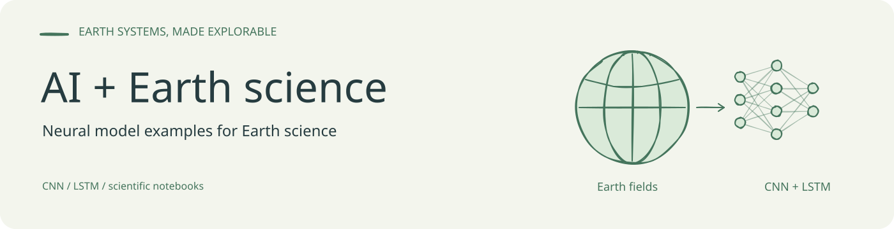
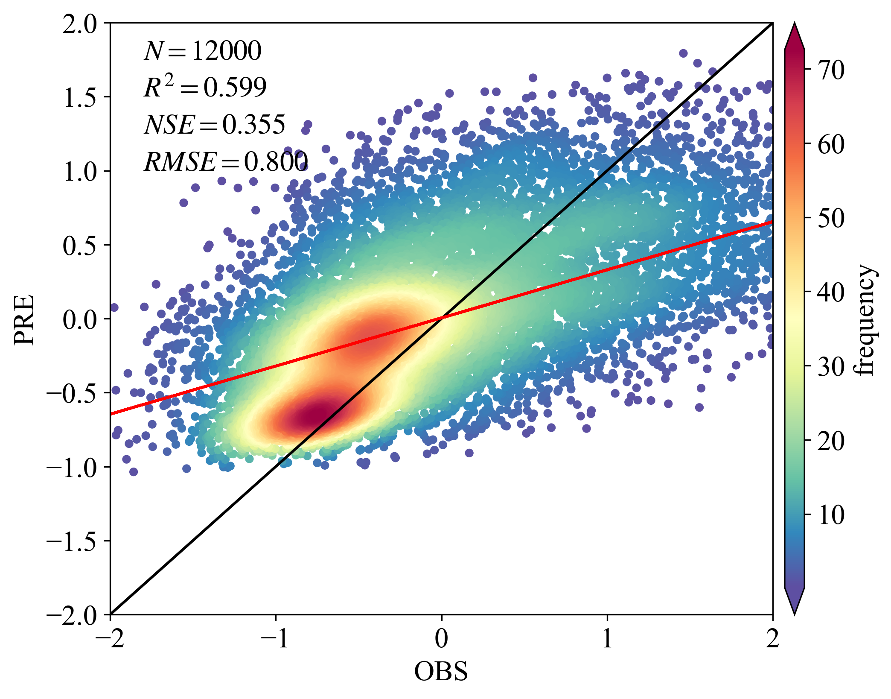

<!-- readme-visual-refresh:banner -->

<!-- /readme-visual-refresh:banner -->

# AImodel-EarthScience
 Some AI model in earth science

<!-- readme-visual-refresh:artwork-source -->
[Editable banner artwork · Excalidraw](assets/readme/banner.excalidraw)
<!-- /readme-visual-refresh:artwork-source -->

<!-- readme-visual-refresh:result -->
## Saved project output

Existing LSTM observed-versus-predicted scatter plot saved in the teaching notebook.

Historical project output, retained from the existing working files; it was not rerun for this documentation update. Training, validation and test spatial samples may overlap; this is not independent out-of-sample validation.

Source: `LSTM/LSTM.ipynb [zero-based cell 17, output 0]`.
<!-- /readme-visual-refresh:result -->
